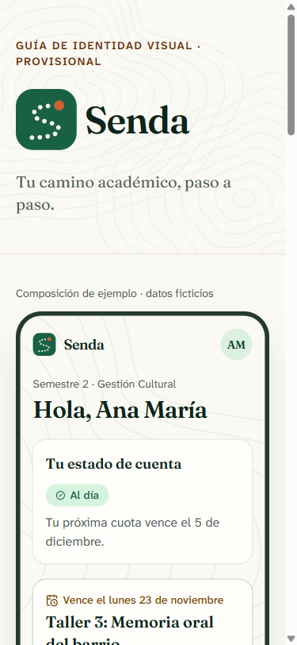
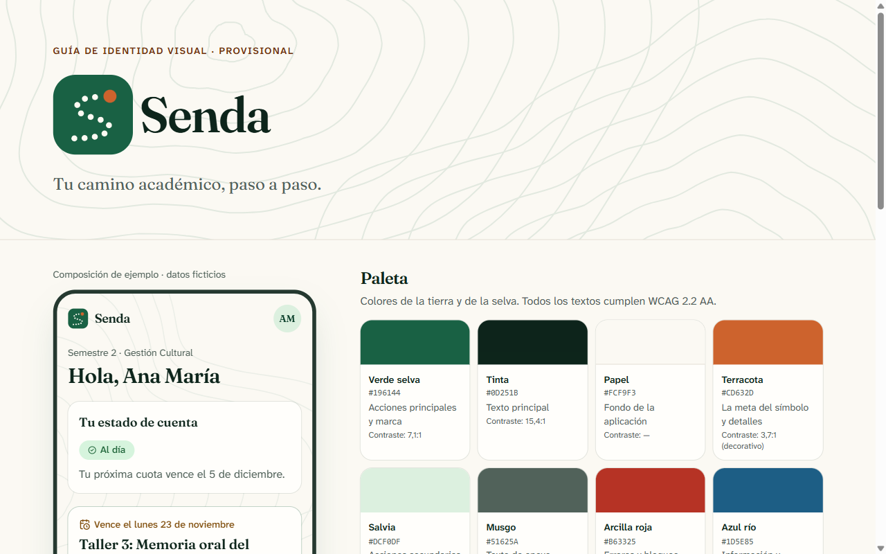
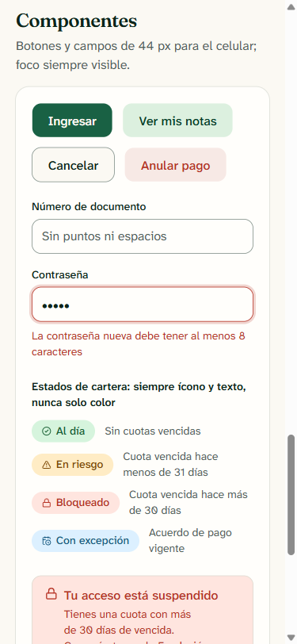
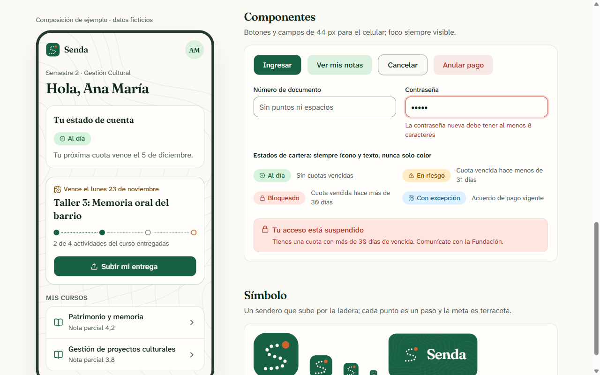

# Identidad visual de Senda

- **Estado:** aprobada por Aymer el 2026-11-16 (tarea 2.0)
- **Fecha:** 2026-11-16
- **Dónde se ve:** `npm run dev` y abrir `http://localhost:5173/guia`. La guía viva existe solo en desarrollo; el build de producción la descarta.

Todas las pantallas siguen esta guía. La tarea 6.2 las revisa contra ella con capturas en 375 px y 1280 px.

## Concepto: "Senda, paso a paso"

Una senda es un camino que se recorre a pie, paso a paso, como un semestre. Ese concepto da los tres elementos de la marca:

- **El símbolo:** un sendero punteado que sube en zigzag por una ladera hasta la meta. Cada punto es un paso y la meta es terracota. El trazo se lee además como una "S".
- **Las curvas de nivel:** la textura de fondo, como en un mapa topográfico del camino.
- **El avance en forma de senda** (`ProgresoSenda`): un punto por actividad, unidos por una línea punteada, con la meta en terracota. Es el elemento propio que se repite en las pantallas del estudiante.

La paleta viene de la tierra y la selva: papel crema, verde selva y barro. Se evitan a propósito el gris de plantilla y los degradados morados típicos de las interfaces generadas.

| Celular (375 px) | Escritorio (1280 px) |
|---|---|
|  |  |
|  |  |

## Paleta

Los tokens viven en `web/src/index.css` (formato OKLCH, el de Tailwind 4 y shadcn/ui). Cada par de texto y fondo se midió con la fórmula de WCAG 2.2: **4,5:1** para texto y **3:1** para bordes de campos y foco (criterio 1.4.11). **Si cambias un color, vuelve a medir el contraste.**

| Nombre | Token | Hex | Uso | Contraste |
|---|---|---|---|---|
| Papel | `background` | `#FCF9F3` | Fondo de la aplicación | — |
| Tinta | `foreground` | `#0D251B` | Texto principal | 15,4:1 sobre papel |
| Verde selva | `primary` | `#196144` | Acción principal, marca, enlaces | 7,1:1 con texto crema; 7,1:1 como texto |
| Salvia | `secondary` | `#DCF0DF` | Acciones secundarias | 10,3:1 con su texto |
| Musgo | `muted-foreground` | `#51625A` | Texto de apoyo | 6,1:1 sobre papel |
| Barro claro | `accent` | `#FDE5CE` | Resaltados | 7,9:1 con su texto `#723311` |
| Arcilla roja | `destructive` | `#B63325` | Errores, bloqueo, acciones irreversibles | 5,7:1 sobre papel |
| Borde de campo | `input` | `#819089` | Borde de campos y botones de contorno | 3,2:1 (1.4.11) |
| Foco | `ring` | `#1F855D` | Anillo de foco | 4,4:1 |
| Terracota | `terracota` | `#CD632D` | La meta del símbolo y detalles | 3,7:1: **solo decorativa, nunca texto** |

**Estados de cartera (D6).** Cada uno tiene un texto fuerte y un fondo suave:

| Estado | Variante de `Badge` | Texto | Fondo | Contraste | Ícono (lucide) |
|---|---|---|---|---|---|
| Al día | `exito` | `#1B6236` | `#D6F4DD` | 6,3:1 | `CircleCheck` |
| En riesgo | `alerta` | `#7D4A07` | `#FFECC5` | 6,3:1 | `TriangleAlert` |
| Bloqueado | `peligro` | `#B63325` | `#FFE5DF` | 5,0:1 | `Lock` |
| Con excepción | `info` | `#1D5E85` | `#DCF0FF` | 6,0:1 | `CalendarClock` |

**El estado nunca se comunica solo con color:** siempre lleva ícono y texto. Así lo entienden también quienes no distinguen colores.

## Tipografía

| Uso | Familia | Por qué |
|---|---|---|
| Títulos (`h1` a `h4`, `font-heading`) | **Fraunces** (variable, con tamaño óptico) | Serif cálida y con carácter: da identidad sin perder seriedad académica |
| Texto, formularios y números (`font-sans`) | **Atkinson Hyperlegible Next** (variable) | Diseñada por el Braille Institute para personas con baja visión. Distingue los caracteres que se confunden (I l 1, O 0), algo clave para leer documentos y contraseñas temporales desde el celular |

- Se sirven desde el propio Worker con paquetes de Fontsource: no se le piden a Google, así el navegador no le revela a terceros quién visita la plataforma. El navegador descarga solo los subconjuntos de caracteres que necesita: unos 100 KB la primera vez, y después quedan en caché.
- Los números que se comparan (notas, dinero) usan `tabular-nums`, para que las cifras queden alineadas en las tablas.
- Formatos de presentación de Colombia (es-CO): dinero `$ 250.000`, notas con coma decimal `4,2` y fechas en palabras ("lunes 23 de noviembre"). Cómo se guardan los datos lo define design.md D9.

## Símbolo y marca

- El símbolo es `SimboloSenda` (`web/src/components/marca/SimboloSenda.tsx`), y `public/favicon.svg` es la misma figura con los colores fijos.
- `Marca` combina el símbolo y el nombre. **El nombre llega siempre de la configuración** (`PRODUCTO_NOMBRE`, D19), nunca escrito en el código.
- Tamaño mínimo: 16 px (favicon). El símbolo es decorativo (`aria-hidden`), salvo que reciba un título.
- Sobre verde selva, las curvas de nivel se pintan en crema (`[--tinta-curvas:var(--primary-foreground)]`).
- Es un logotipo **provisional**. Si la Fundación entrega su identidad, se reemplazan el símbolo y la paleta en un solo lugar: los tokens y el componente.

## Componentes

- **shadcn/ui primero** (D3). Se busca con el MCP de shadcn (pasando `registries: ["@shadcn"]`) y se instala con `npx shadcn add`.
- Tamaños ajustados para el celular:
  - Botones: 40 px por defecto y 44 px (`size="lg"`) para la acción principal de cada pantalla.
  - Campos: 44 px de alto, con texto de 16 px también en escritorio, porque con menos el iPhone hace zoom al escribir.
- Botones de contorno y campos usan el borde `input` (3,2:1), no el `border` decorativo.
- Errores de formulario: `aria-invalid` en el campo y el mensaje en `text-destructive`, enlazado con `aria-describedby`. El texto es el mismo `mensaje` que envía la API (`{ codigo, mensaje }`).
- Avisos (`Alert`): el bloqueo por mora usa `variant="destructive"` sobre `bg-peligro-suave`, con el contacto de la Fundación tomado de la configuración.

## Tono de la escritura

- **Español claro, de tú** y en frases cortas: "Ingresa de nuevo", "Sube tu entrega".
- **Decir qué pasó y qué hacer:** "Tu sesión terminó. Ingresa de nuevo"; "Tienes una cuota con más de 30 días de vencida. Comunícate con la Fundación."
- **Sin culpar ni alarmar.** Se dice "Tu acceso está suspendido" y no "Usuario moroso"; "No tienes permiso para esta operación" y no "Acceso prohibido".
- **Sin jerga técnica** frente a estudiantes y docentes: nada de "token", "error 401" ni "sesión inválida".
- Los botones dicen la acción con un verbo: "Subir mi entrega", "Registrar pago", nunca "Aceptar" a secas.

## Movimiento

- Una sola entrada al cargar cada pantalla, de **250 ms** (`animate-in fade-in slide-in-from-bottom-2 duration-250`), escalonada de 40 en 40 ms y sin animaciones decorativas que se repitan. Todo queda visible en menos de medio segundo.
- Es corta a propósito: las pantallas se recorren muchas veces al día (un docente revisa decenas de entregas) y una entrada larga se siente lenta. Para transiciones de interfaz se recomiendan de 200 a 300 ms.
- Siempre con `motion-reduce:animate-none`: si la persona pidió "reducir movimiento" en su sistema, no hay animación. Las capturas de esta guía se tomaron así.

## Accesibilidad (WCAG 2.2 AA)

- Contraste medido para cada token (tablas de arriba).
- El foco siempre es visible: anillo `ring` de 3 px. Nunca se le pone `outline-none` sin un reemplazo.
- Objetivos táctiles de 40 a 44 px.
- Todo campo tiene su `Label`.
- Los íconos decorativos llevan `aria-hidden`.
- `ProgresoSenda` tiene una etiqueta de texto para los lectores de pantalla.
- Se respeta "reducir movimiento".
- Solo hay tema claro en el MVP. El bloque `.dark` de shadcn se conserva, pero nada lo activa.

## Pantallas: cómo se verifican

Ninguna pantalla se da por terminada sin capturas en **375 px** y **1280 px** revisadas contra esta guía, sin desplazamiento horizontal y sin errores en la consola (MCP de Playwright).
