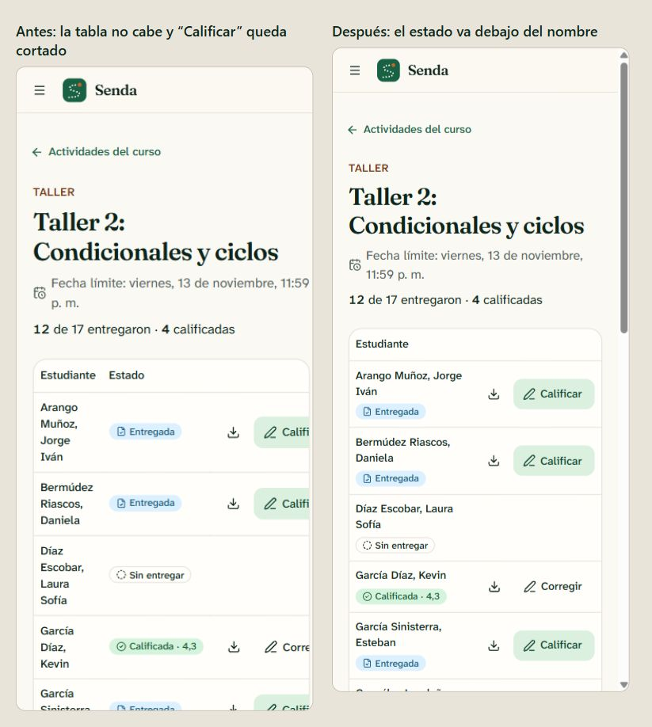

# Revisión visual de todas las pantallas (tarea 6.2)

**Fecha:** 19 de noviembre de 2026 · **Contra:** [docs/identidad-visual.md](../identidad-visual.md) · **Herramienta:** MCP de Playwright · **Estado:** ✅ 4 correcciones aplicadas; las demás diferencias se descartaron después de verificarlas

## Método

1. **Recorrido automático con el MCP de Playwright** ([recorrido-visual-mcp.js](recorrido-visual-mcp.js)). Entra con cada cuenta de [CUENTAS-DEMO.md](../../db/seed/CUENTAS-DEMO.md) y recorre 25 pantallas en 375 px (celular) y 1280 px (escritorio), con "reducir movimiento" y `devicePixelRatio = 1`.
   - Pantallas: ingreso, ingreso bloqueado, cambio de contraseña temporal, 9 del estudiante, 4 del docente y 8 de la administración. Aparte se revisaron el aviso de privacidad y los diálogos de calificar y de registrar pago, que se usan en la demo.
   - En cada una toma la captura de página completa y mide lo que la guía pide: desplazamiento horizontal, errores en la consola, tipografías, botones sin nombre, campos sin etiqueta, objetivos táctiles de menos de 24 px y texto en terracota, que es solo decorativa.
2. **Revisión visual** de las 56 capturas (50 del recorrido, 2 del aviso de privacidad y 4 de los diálogos) en hojas de contacto, con las pantallas lado a lado. Así se comparan entre sí: encabezados, tarjetas, estados y espaciado.
3. **Verificación** de cada posible hallazgo en la pantalla real antes de corregir. Dos resultaron ser efectos de la captura de página completa, no defectos.

## Mediciones automáticas (50 capturas)

| Medición | Resultado |
|---|---|
| Desplazamiento horizontal | 0 px en todas las pantallas y anchos |
| Tipografía | Títulos en Fraunces y texto en Atkinson Hyperlegible Next en todas |
| Botones sin nombre accesible | 0 |
| Campos sin etiqueta | 0 |
| Texto en terracota | 0 |
| Errores en la consola | Solo los esperados: 401 de `/api/auth/yo` antes de ingresar y 403 del ingreso de la estudiante bloqueada |
| Objetivos táctiles pequeños | "Ver mis cuotas y pagos" (20 px de alto, corregido) y "Saltar al contenido", que solo aparece con el teclado y entonces mide 132 × 24 px |

## Hallazgos y correcciones

| # | Pantalla | Diferencia con la guía | Corrección |
|---|---|---|---|
| 1 | Entregas de una actividad (docente), 375 px | La tabla no cabía: nombres en 4 líneas y el botón "Calificar" cortado; había que desplazar la tabla de lado | En el celular el estado va debajo del nombre y se oculta la columna "Estado". En escritorio no cambia |
| 2 | Inicio y "Mis cursos" del docente, 375 px | La etiqueta "por calificar" al lado del curso partía el texto en líneas muy cortas | En el celular la etiqueta va debajo del texto |
| 3 | Inicio del estudiante | "Ver mis cuotas y pagos" era un enlace de texto de 20 px de alto; la guía pide objetivos táctiles de 40 a 44 px | Botón de contorno de 40 px, como "Ver entregas" en las pantallas del docente |
| 4 | Diálogo de calificar | El campo Nota mostraba "4,2" como texto de ejemplo: un valor real de ejemplo se confunde con una nota ya puesta | Sin texto de ejemplo; la ayuda "De 0,0 a 5,0, con un decimal" explica el formato |

## Descartados después de verificarlos

- **Asistente en 375 px.** En la captura de página completa, la barra para escribir tapaba dos sugerencias. En la pantalla real se ven todas al desplazarse: la última termina en y = 578 y la barra empieza en y = 646.
- **Aviso de privacidad en 1280 px.** En la captura de página completa, el panel verde terminaba a los 800 px. En la pantalla real es `sticky`: después de 486 px de desplazamiento sigue arriba, con el alto de la ventana.

## Lo que quedó igual y cumple la guía

- Encabezado, títulos y tarjetas consistentes entre los tres roles.
- Los estados de cartera y de entrega siempre llevan ícono y texto.
- Formatos de Colombia: notas con coma decimal ("3,9 de 5,0"), dinero "$ 360.000" y fechas en palabras.
- Botones principales de 44 px y diálogos con los botones apilados en el celular.

## Verificación de las correcciones

- Nuevas capturas en 375 y 1280 px. La tabla de entregas ya no se desborda, "Calificar" queda dentro de la pantalla y "Ver mis cuotas y pagos" mide 197 × 40 px.
- `npm run lint`, `npm run typecheck`, 393 pruebas de Vitest y el E2E (flujo de la demo y asistente) en verde.

Las capturas de esta revisión quedan en `.playwright-mcp/revision-6-2/`, que no se versiona. Para repetirla, corre el recorrido con el MCP de Playwright, como se explica al inicio del script.
